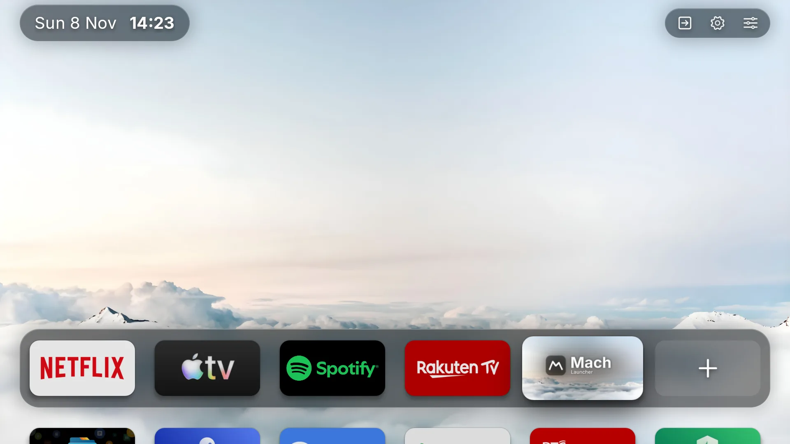
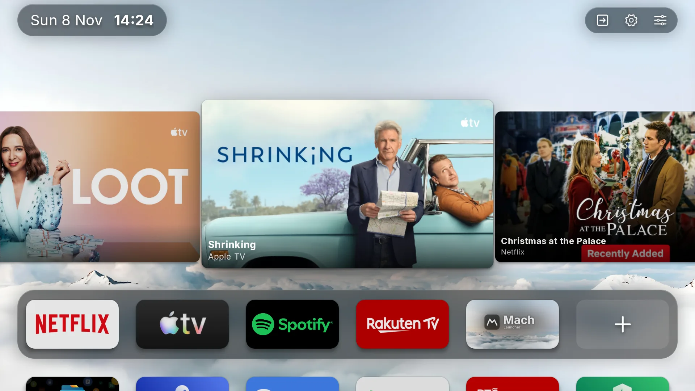
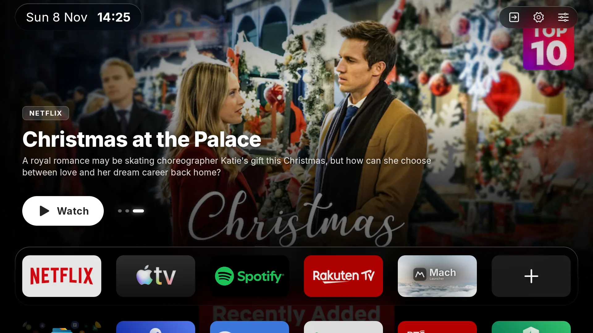
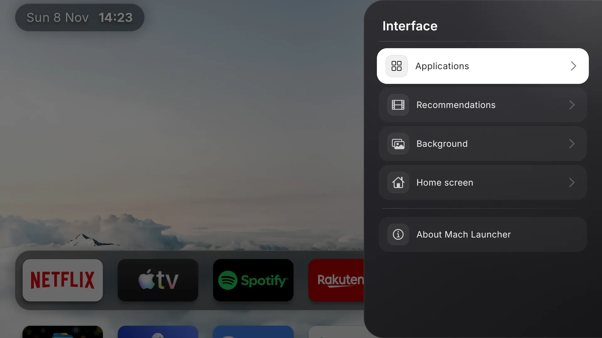

# Mach Launcher

A launcher for Android TV: a dock of favourite apps, a grid of every TV app, and titles from your streaming apps on Home.

## Screenshots

  
  

  
  

## Features

- **Dock:** up to six favourite apps on frosted glass, in the order you set. A "+" tile adds the next one.
- **Apps grid:** every app with a TV entry, six across, A to Z until you move a tile. Phone-only apps are left out.
- **Recommendations:** titles from Android's Play Next list and from apps that publish TV channel rows. They show as a row of cards, or as a full-screen hero with the title's artwork behind Home. Each source has its own switch, and every source starts off.
- **Backgrounds:** a dark or light gradient; a bundled cloud photo by night, by day, or switching with the time of day; or a photo from the TV. The cloud photos are bundled for 1080p and 4K screens.
- **Status bar:** the date and clock on the left; the TV's inputs menu, Android's Settings and Mach's settings on the right.
- **App panel:** hold OK on a tile to move it, open it, add it to or remove it from the dock, hide it, open its app info or uninstall it.
- **Updates:** About → Check for updates shows the latest release's changes, downloads it and opens Android's installer.

## Requirements

Android TV 7.0 or later.

## Install

Download `mach-launcher-universal-release.apk` from [Releases](https://github.com/terminalis/mach-launcher/releases/latest) and install it on the TV.

Or add the terminalis F-Droid repository to an F-Droid client, which then installs Mach and its updates. [terminalis/packages](https://github.com/terminalis/packages#android) has its address.

Mach appears in the TV's app list. On devices that offer a choice of Home app, it can be chosen there.

## Permissions

- **TV listings:** reads other apps' channel rows for recommendations. Home shows a banner to grant it.
- **Photos:** asked the first time you choose a custom image.
- **Install unknown apps:** asked the first time you install an update from About.
- **Accessibility:** the Home screen switch below.

## Home screen

On many TVs the built-in launcher keeps the Home button even when another launcher is the default. Mach takes it over with an accessibility switch, set up on the TV with the remote:

1. Some TVs have an app that decides which apps may start by themselves. If yours does, allow Mach Launcher there.
2. Open Settings → Device Preferences → Accessibility, choose Mach Launcher and turn it on.

The TV warns that the switch can collect what you type; it shows that warning for every accessibility app. Mach's switch is only told which app has come to the front: it can't read the screen or see your key presses.

To go back, press Reset Home screen in Mach's Settings → Home screen.

## Build

Requires JDK 21 and the Android SDK.

    ./gradlew assembleDebug

The debug build installs beside a release as `io.github.terminalis.machlauncher.debug`.

## Credits

Forked from [Arc Launcher](https://github.com/meddouribadis/arclauncher) 1.2.0 by Badis Meddouri, which builds on [LTvLauncher](https://github.com/LeanBitLab/LtvLauncher) and [FLauncher](https://gitlab.com/flauncher/flauncher). Text is set in [Inter](https://github.com/rsms/inter), under the SIL Open Font License.

## License

GNU General Public License v3.0. See [LICENSE](LICENSE).
